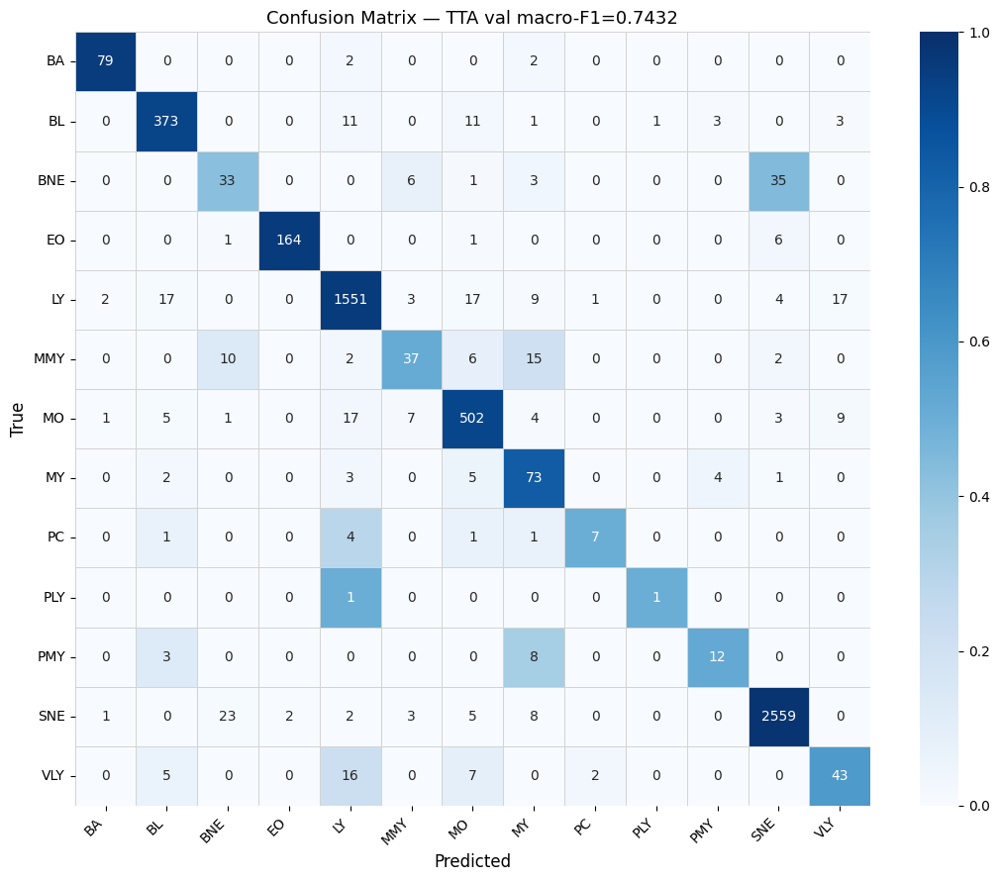

# White Blood Cell Classification

ConvNeXt-based classification of microscopy images into 13 white blood cell
types. This project was developed for the IMA205 Challenge at Telecom Paris in
2026.

The main difficulty is severe class imbalance: the largest class contains
13,015 training images, while the rarest contains only 11. The pipeline combines
adaptive denoising, transfer learning, class-weighted training, and test-time
augmentation to improve performance on rare classes.



## Method

- Adaptive median filtering based on an image-level impulse-noise score
- Center crop from `368 x 368` to `300 x 300` pixels
- ConvNeXt-Base pretrained on ImageNet-21k and fine-tuned on ImageNet-1k
- Two-phase fine-tuning: classification head first, then the full network
- Square-root inverse-frequency class weights with label smoothing
- Geometric augmentation and mild Gaussian blur during training
- Deterministic eight-view test-time augmentation using square symmetries
- Evaluation with macro-averaged and per-class F1 scores

## Results

The scores below are from the original challenge run documented in the report.
They are not regenerated during repository setup.

| Stage | Macro-F1 |
| --- | ---: |
| Head-only fine-tuning, single view | 0.5937 |
| Full fine-tuning, single view | 0.7425 |
| Full fine-tuning with eight-view TTA | **0.7432** |
| Public test score | **0.7675** |

The public test score was calculated on the 30% portion of the test set made
available during the challenge.

The strongest results were obtained for frequent and visually distinctive cell
types. Remaining errors were concentrated among very rare classes and
morphologically similar categories, particularly adjacent maturation stages.

## Repository Structure

```text
.
|-- assets/
|   |-- confusion_matrix.png
|   `-- denoising_examples.png
|-- notebooks/
|   `-- wbc_classification.ipynb
|-- .gitignore
|-- README.md
|-- report.pdf
`-- requirements.txt
```

## Data

The challenge dataset is not included in this repository. Place the authorized
course data in the following structure:

```text
data/
|-- train/
|   `-- <image_id>.png
|-- test/
|   `-- <image_id>.png
|-- train_metadata.csv
`-- test_metadata.csv
```

`train_metadata.csv` must contain `ID` and `label` columns.
`test_metadata.csv` must contain an `ID` column.

To keep the data elsewhere, set `WBC_DATA_ROOT` to the directory containing the
images and metadata files.

## Installation

```bash
python -m venv .venv
pip install -r requirements.txt
jupyter lab
```

Open `notebooks/wbc_classification.ipynb` and run the cells in order. A CUDA GPU
is strongly recommended for fine-tuning ConvNeXt-Base. Reduce `BATCH_SIZE` if
GPU memory is limited.

Training checkpoints, generated figures, and submissions are written to
`outputs/` and are excluded from version control.

## Report

The full methodology, experiments, per-class results, and error analysis are
available in [report.pdf](report.pdf).

## Limitations

- Several classes contain too few samples for reliable estimation.
- Some labels describe gradual biological transitions with ambiguous boundaries.
- The reported test score covers only the public 30% test split.
- The model has not been externally or clinically validated.

This repository is an educational research project and is not intended for
clinical diagnosis or decision-making.
